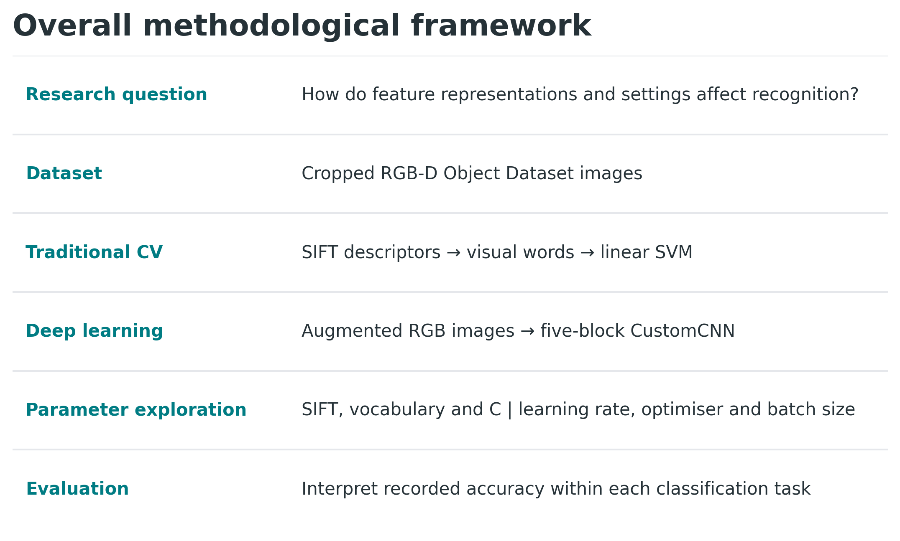
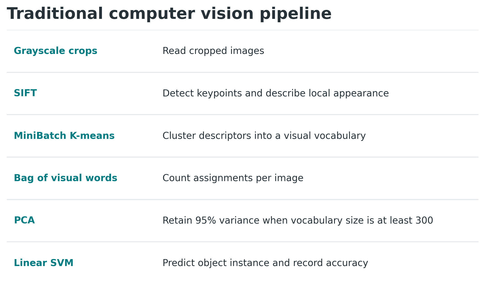
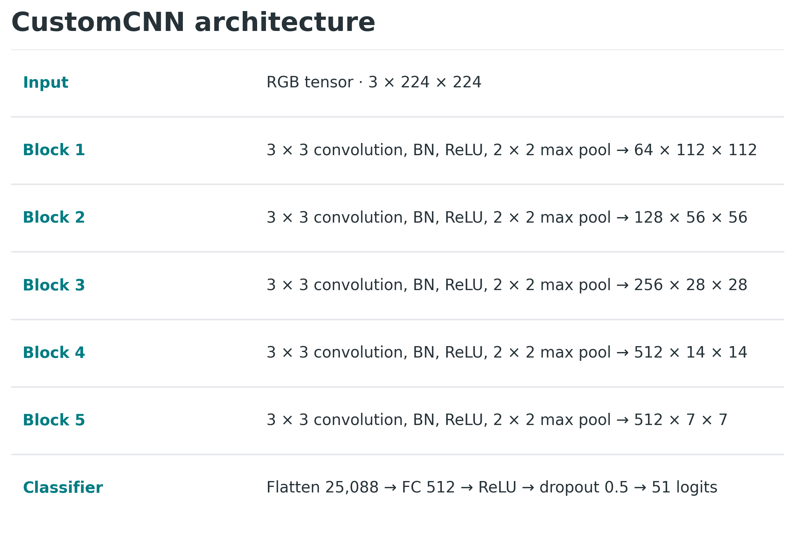

# Comparative Image Recognition: From Handcrafted Features to Deep Learning

## 1. Project Overview

This MSc Computer Vision coursework project was completed in the MSc Data Science programme at the University of Manchester. It documents the implementation and parameter exploration of a traditional visual recognition pipeline and a custom convolutional neural network.

## 2. Research Questions

How do different visual feature representations and model configurations influence image recognition performance? The coursework explores how handcrafted and learned representations encode image information, how recognition responds to parameter choices, and how the task conditions inform the interpretation of each result.

## 3. Dataset and Sampling Strategy

The RGB-D Object Dataset contains 51 semantic categories and 300 physical object instances. The notebooks each record 60,000 sampled images and cap sampling at 200 images per instance. The traditional sweep uses grayscale crops and instance labels. The CNN resizes images to 224 × 224 and predicts semantic labels. The final traditional table and the CNN records use stratified 80:20 splits by their respective labels. The supplied traditional notebook preserves a separate 70:30 instance sweep and recall follow-up. See the [dataset documentation](docs/01_dataset.md) for preprocessing and access.

## 4. Methodological Framework

*Figure 01. Overall methodological framework. Methodological illustration based on original coursework. The two branches share a dataset hierarchy and use different prediction targets.*

## 5. Technical Implementation

### 5.1 Traditional Computer Vision

SIFT extracts local descriptors. MiniBatch K-means builds the visual vocabulary, and each image becomes a bag-of-visual-words histogram. The grid applies PCA at vocabulary sizes 300 and 500, then trains a linear SVM. See [traditional computer vision](docs/02_traditional_computer_vision.md).

*Figure 03. Traditional computer vision pipeline. Methodological illustration based on original coursework. The parameter sweep compares handcrafted descriptors, vocabulary sizes and SVM regularisation.*

### 5.2 Custom Convolutional Neural Network

Five convolutional blocks learn image features. A dense classification head uses dropout and produces 51 class scores. The notebook uses cross-entropy loss and records Adam and SGD configurations. See [deep learning](docs/03_deep_learning.md).

*Figure 04. CustomCNN architecture. Methodological illustration based on original coursework. Each pooling operation halves spatial dimensions while the convolutional blocks build channel depth.*

### 5.3 Supplementary Coursework Experiments

The CNN notebook also includes ResNet-18 transfer learning and a separate ResNet-18 parameter exploration. Its stored training and class-level figures belong to that supplementary model.

## 6. Experimental Results

| Recorded experiment | Test accuracy | Conditions |
|---|---:|---|
| Highest recorded final traditional sweep row | 83.06% | 300 instances, 80:20 split, SIFT cap 600 and contrast 0.02, vocabulary 500 with PCA, C = 0.1 |
| CustomCNN training run | 95.78% | 51 categories, 80:20 split, Adam, learning rate 0.001, batch size 32, epoch 10 |
| CustomCNN hyperparameter exploration | 86.21–99.92% | 51 categories, 80:20 split, eight Adam or SGD configurations, epoch 5 |

The [results documentation](docs/04_experimental_results.md) shows SIFT keypoint counts, vocabulary and SVM sensitivity, category recall, and the CNN training and hyperparameter records. The [CSV guide](results/README.md) defines the fields and precision.

## 7. Critical Interpretation

Read the results within each classification task. Instance recognition requires distinguishing individual objects, while semantic recognition groups instances under shared labels. The grid varies vocabulary size alongside the use of PCA at the larger sizes. The [research reflection](docs/05_research_reflection.md) records these interpretation boundaries. The report discusses inspection of local features and CPU suitability in the traditional pipeline alongside the richer learned representations, GPU training cost and reduced interpretability of the CNN.

## 8. Skill Development

Image sampling and label construction connected data preparation to the prediction target. Building a visual vocabulary developed experience in unsupervised feature engineering, while PCA and SVM fitting linked feature representation to supervised classification. Implementing the CNN and recording optimisation settings developed experience in neural modelling, experiment design, quantitative analysis and scientific visualisation.

## 9. Transferable Research Competencies

The same practices could support feature construction for street-view imagery, model configuration in geospatial AI, and integration of visual features with spatial, mobility or environmental data. The [competency mapping](docs/06_transferable_skills.md) describes potential research applications.

## 10. Repository Structure

- [Traditional notebook](notebooks/01_traditional_computer_vision.ipynb) and [CNN notebook](notebooks/02_convolutional_neural_network.ipynb)
- [Recorded result files](results/README.md) and [figure index](docs/04_experimental_results.md)
- [Dependencies](requirements.txt) and [coursework report status](report/README.md)

## 11. Project Scope and References

This repository documents the original MSc computer vision coursework and its recorded experimental outputs. It is presented as evidence of computational implementation, experimental design, analytical skills and transferable research competencies.

The CNN notebook records PyTorch 2.7.0+cu118 with CUDA available on an NVIDIA GeForce RTX 4080 Laptop GPU. The traditional notebook records warnings from scikit-learn on Windows. The dependency list uses package names available from the code. Execution in a new environment is unverified.

Selected references from the original coursework

- Lai, K., Bo, L., Ren, X. and Fox, D. (2011). *A Large-Scale Hierarchical Multi-View RGB-D Object Dataset*. [University of Washington dataset and access information](https://rgbd-dataset.cs.washington.edu/dataset.html)
- Lowe, D. G. (2004). *Distinctive Image Features from Scale-Invariant Keypoints*. International Journal of Computer Vision, 60(2), 91–110. [Publisher record](https://doi.org/10.1023/B:VISI.0000029664.99615.94)
- Sivic, J. and Zisserman, A. (2003). *Video Google: A Text Retrieval Approach to Object Matching in Videos*. ICCV. [Proceedings record](https://doi.org/10.1109/ICCV.2003.1238663)
- He, K., Zhang, X., Ren, S. and Sun, J. (2016). *Deep Residual Learning for Image Recognition*. CVPR, 770–778. [Proceedings record](https://doi.org/10.1109/CVPR.2016.90)
- Voulodimos, A., Doulamis, N., Doulamis, A. and Protopapadakis, E. (2018). *Deep Learning for Computer Vision: A Brief Review*. Computational Intelligence and Neuroscience. [Publisher record](https://doi.org/10.1155/2018/7068349)
