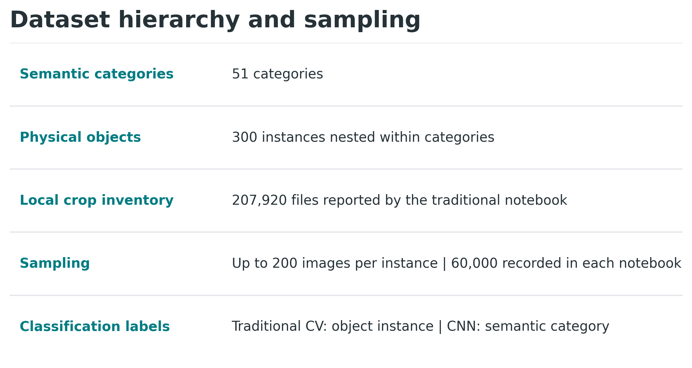

# Dataset and sampling

The [University of Washington RGB-D Object Dataset](https://rgbd-dataset.cs.washington.edu/) provides the collection and acquisition information. The notebooks use images from the local cropped dataset tree. The traditional notebook recorded 207,920 crop images in the local inventory.

*Figure 02. Dataset hierarchy and sampling. Methodological illustration based on original coursework. Physical instances are nested within semantic categories. Sampling occurs at instance level in both notebooks.*

| Configuration | Traditional CV | CNN |
|---|---|---|
| File selection | Filenames ending in `_crop.png` | PNG files copied by parent category, with instance prefixed to filenames |
| Sampling | Up to 200 per physical instance, 60,000 in the saved runs | Up to 200 per physical instance, 60,000 in the saved run |
| Prediction label | Object instance | Semantic category |
| Input preparation | Grayscale for SIFT | RGB resized to 224 × 224, then tensor conversion |
| Training and test split | 80:20 for the final coursework table. The supplied notebook records a 70:30 sweep stratified by instance with random state 42 | 48,000 training and 12,000 test images, stratified by category, seed 42 |
| Follow-up | 70:30 stratified recall split, random state 42 | Separate ResNet-18 runs use the CNN data preparation |

CNN augmentation applies horizontal flip with probability 0.2, rotation up to 15 degrees and brightness, contrast and saturation jitter of 0.2 on the training transforms. The test transform resizes and converts to a tensor. Set `RGBD_DATASET_ROOT` to the cropped data directory. The CNN also uses `RGBD_PROCESSED_ROOT` for the reorganised image tree. Use the provider’s data download page to obtain the cropped RGB and depth archive and unpack the category and instance hierarchy. The provider limits the dataset to non-commercial research and educational use. [Dataset and access terms](https://rgbd-dataset.cs.washington.edu/dataset.html)
