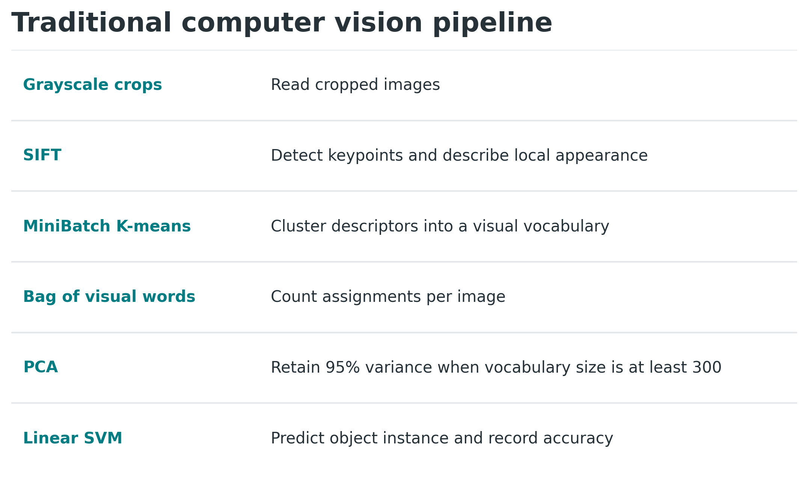

# Traditional computer vision

The experiment varies characteristics of handcrafted features and their classifier on the 300-instance problem.

*Figure 03. Traditional computer vision pipeline. Methodological illustration based on original coursework. The parameter sweep compares handcrafted descriptors, vocabulary sizes and SVM regularisation.*

1. **SIFT** describes local gradient patterns around detected keypoints. The notebook reads crops in grayscale, counts descriptors per image and records the average keypoint count. The tested feature caps are 200, 300, 400, 500 and 600. The eight settings use contrast thresholds between 0.02 and 0.05, with edge threshold 10 and sigma 1.6.
2. **MiniBatch K-means** pools descriptors to build vocabularies of 100, 300 or 500 clusters. The clustering batch size is 1,000 and the random state is 42.
3. **Bag of visual words** converts a variable number of descriptors into a fixed-length histogram of cluster assignments.
4. **PCA** retains 95% of variance for the 300- and 500-word vocabularies. The notebook constructs the vocabulary and applies PCA before the split in the recorded sweep.
5. **Linear SVM** fits the instance labels for C values 0.1, 1 and 10. The final coursework table records training and test accuracy for 72 settings under the 80:20 split. The supplied traditional notebook separately records test accuracy and SVM elapsed time for 72 settings under a 70:30 split. Both workflows use PCA at the two larger vocabulary sizes.

The recall follow-up rebuilds histograms for the highest-accuracy setting from the notebook’s 70:30 grid, uses a 70:30 stratified split and fits a linear SVM directly to the histograms. It computes instance precision, recall and F1, then averages instance recall within semantic categories. See the [recorded results](04_experimental_results.md).
