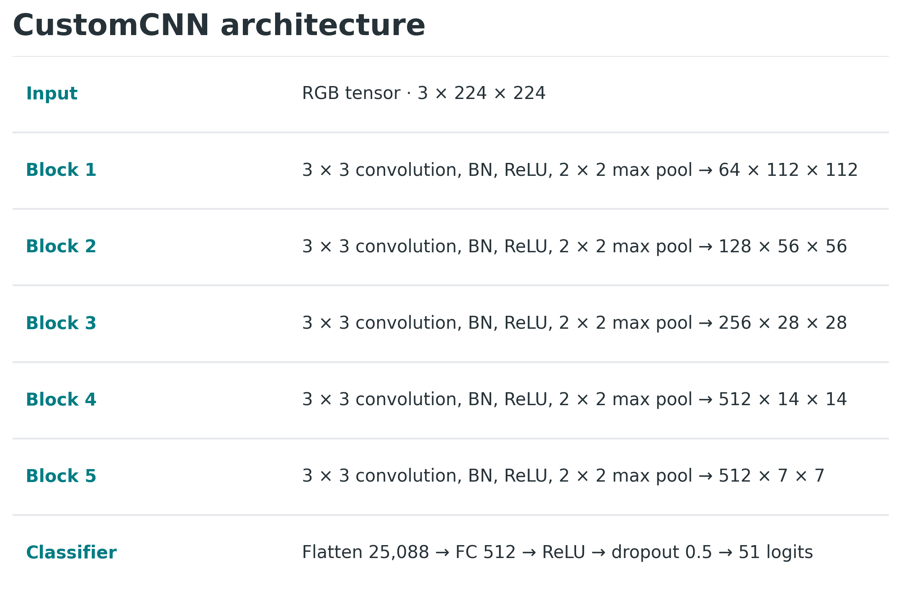

# Deep learning

The CNN notebook explores learned RGB representations for the 51-category prediction task. [Dataset and sampling](01_dataset.md) describes its resize, training augmentation and stratified split.

*Figure 04. CustomCNN architecture. Methodological illustration based on original coursework. Each pooling operation halves spatial dimensions while the convolutional blocks build channel depth.*

Each block uses a padded 3 × 3 convolution, batch normalisation, ReLU and 2 × 2 max pooling. The convolution preserves spatial size. The pooling reduces each spatial dimension by half. The final 512 × 7 × 7 tensor is flattened and mapped through a 512-unit dense layer, ReLU and dropout of 0.5 before the classifier returns category logits.

The recorded CustomCNN training run uses cross-entropy loss, Adam at learning rate 0.001, batches of 32 and ten epochs. The later CustomCNN grid initialises a model per setting and trains for five epochs using either Adam or SGD with momentum 0.9. Learning rates are 0.001 and 0.0001. Batch sizes are 32 and 64. The output prints mean batch loss and test accuracy for each epoch.

## Supplementary ResNet-18 experiments

Earlier notebook cells retain the ResNet-18 transfer-learning run, its training loss and accuracy plots, class-level results and a separate hyperparameter sweep. In the initial run Adam optimises the replacement classification head. The notebook reports 99.45% training and 99.17% test accuracy for that run. The CustomCNN CSV files are sourced exclusively from CustomCNN cells.
