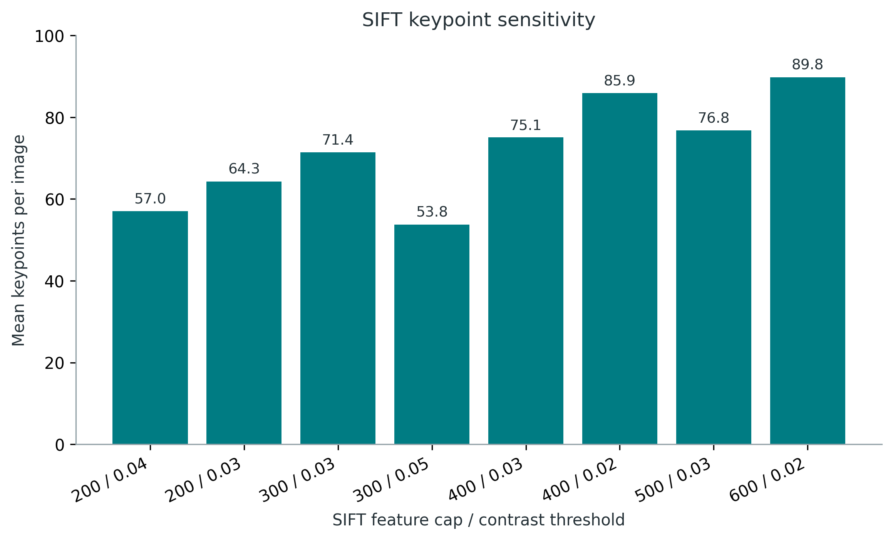
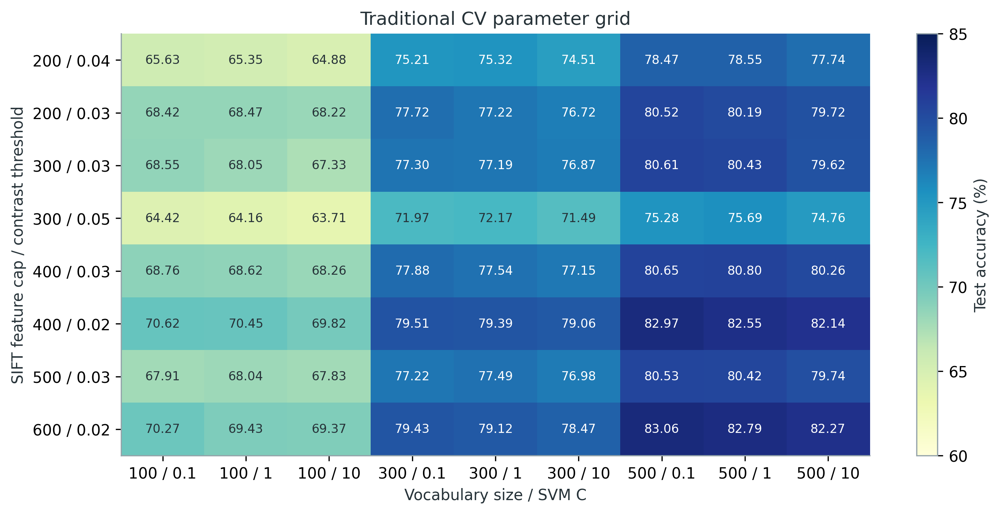
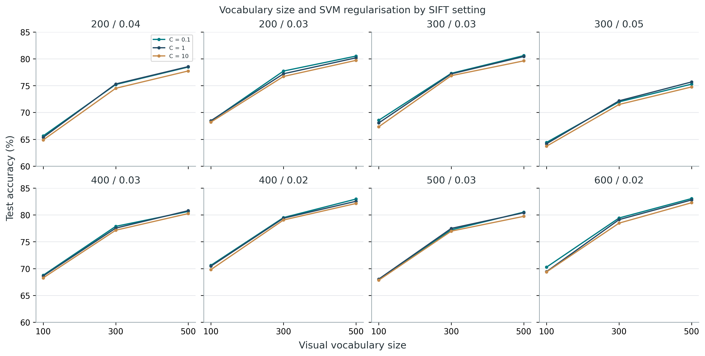
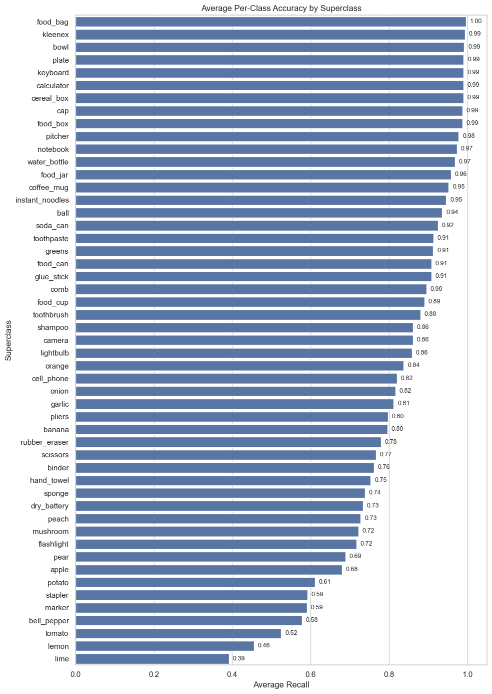
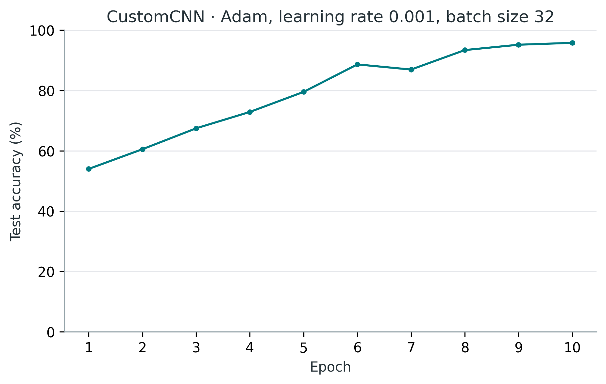
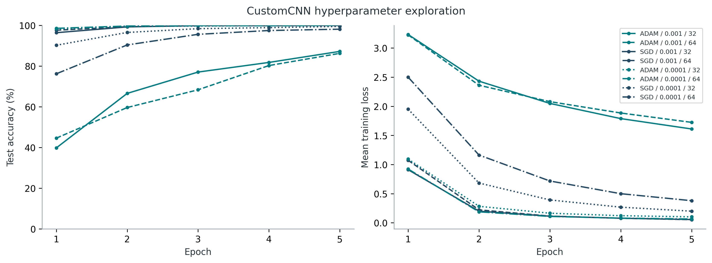
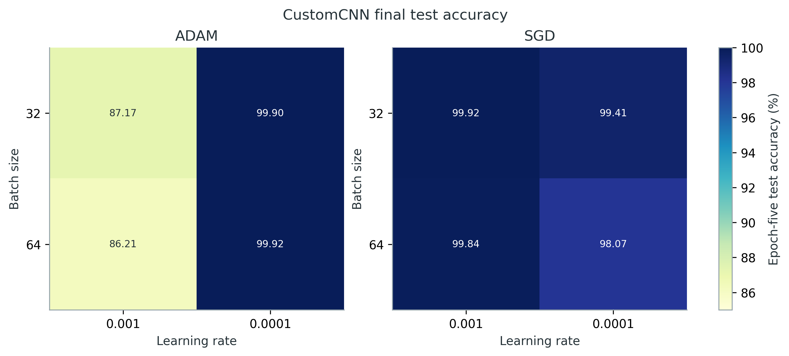

# Recorded experimental results

## Traditional CV

The final 72-row table uses a stratified 80:20 split of 60,000 crops across 300 object instances. The top row records 95.70% training accuracy and 83.06% test accuracy with SIFT cap 600, contrast 0.02, edge threshold 10, sigma 1.6, vocabulary size 500 with PCA and SVM C = 0.1.

*Figure 05. SIFT keypoint sensitivity. Redrawn from original coursework results. Mean keypoints per image for the eight recorded settings on 60,000 crops. Edge threshold is 10 and sigma is 1.6 throughout.*

*Figure 06. Traditional CV parameter grid. Redrawn from original coursework results. Test accuracy for the 300-instance task under the stratified 80:20 split. PCA is applied at vocabulary sizes 300 and 500.*

*Figure 07. Vocabulary size and SVM regularisation. Redrawn from original coursework results. Each panel holds the SIFT setting fixed and shows the recorded instance-level test accuracy across vocabulary and C settings.*

The supplied traditional notebook records a separate 70:30 sweep. Its highest printed test accuracy is 82.12% (SIFT cap 600, contrast 0.02, vocabulary 500 with PCA and C = 0.1). The [70:30 sweep CSV](../results/sift_bow_svm_notebook_70_30.csv) preserves the printed test accuracy and SVM elapsed time for each setting. The notebook's category aggregation is from the separate instance recall procedure described in [traditional computer vision](02_traditional_computer_vision.md).

*Figure 08. Category-level recall. Original coursework figure. The notebook groups instance recall by semantic category for the 70:30 follow-up using SIFT 600 / 0.02 / 10 / 1.6, vocabulary 500 and C = 0.1. The original axis shows recall as a fraction.*

## CustomCNN

The ten-epoch run records 95.19% training accuracy and 95.78% test accuracy at completion. The saved text gives test accuracy each epoch. It does not give numeric per-epoch training losses for this run. The grid records both metrics for each five-epoch configuration on the same 51-category task. The report highlights SGD at learning rate 0.001 and batch size 32, with 99.92% test accuracy and mean training loss 0.0559 at epoch five. The saved output also records 99.92% at the displayed precision for Adam at 0.0001 and batch size 64. The charts and CSV use the saved per-configuration records.

*Figure 09. CustomCNN training performance. Redrawn from original coursework results. Ten epochs of test accuracy on the 51-category task with an 80:20 split, Adam, learning rate 0.001 and batch size 32.*

*Figure 10. CustomCNN hyperparameter exploration. Redrawn from original coursework results. Recorded test accuracy and mean batch training loss across five epochs for the eight optimiser, learning-rate and batch-size settings on the 51-category split.*

*Figure 11. CustomCNN hyperparameter heatmap. Redrawn from original coursework results. Epoch-five test accuracy on the 51-category split with a shared percentage scale for Adam and SGD.*

See the [result provenance and units](../results/README.md).
