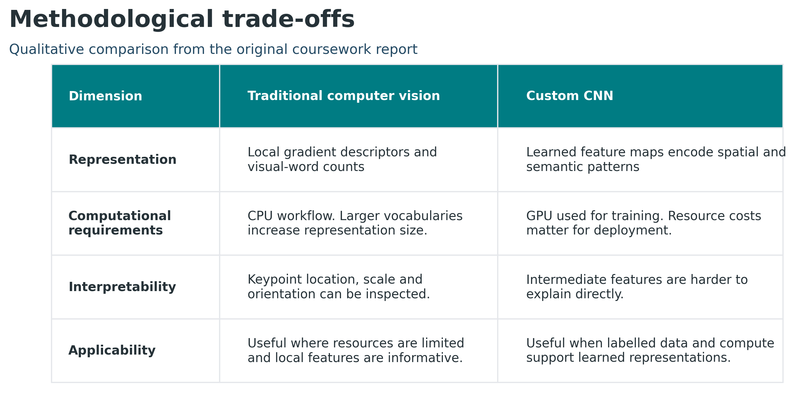

# Research reflection

The coursework compares two ways of representing visual information. SIFT exposes the detected local features and lets the practitioner inspect descriptor counts before clustering. The CNN learns successive feature maps from RGB inputs and compresses their spatial resolution through pooling. These are different implementation choices for representing an image before classification.

The original result records support interpretation within each task. The traditional grid changes the vocabulary and applies PCA at the larger sizes. Its independent follow-up groups recall from an instance classifier by semantic category. The CNN grid exposes the effects of varying training settings within the category task. The different label definitions prevent a controlled performance ranking from their reported accuracy.

The saved notebooks document a Windows traditional CV run and a CUDA CNN environment. The report (Sections 2.1, 2.4.4 and 3) discusses local feature inspection, limited high-level semantics in handcrafted features, and the greater training-resource and labelling requirements of CNNs. It treats lightweight processing and richer learned representation as different design priorities.

*Figure 12. Methodological trade-offs. Methodological illustration based on original coursework. The comparison summarises the report's qualitative discussion and its comparison table.*

Section 2.4.2 associates lower traditional recall with some visually similar groups and higher recall with several clearly structured objects. Sections 2.3.4 and 2.4 emphasise the sensitivity of CNN results to the training settings. The output logs provide the per-setting values for that interpretation. The report identifies hybrid features and multimodal fusion as future directions.
