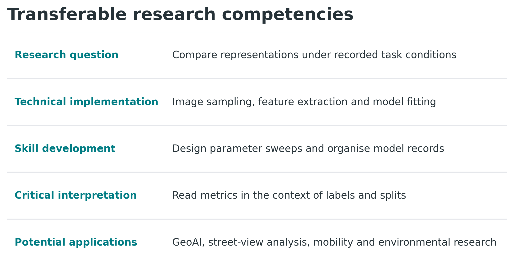

# Transferable research competencies

*Figure 13. Transferable research competencies. Methodological illustration based on original coursework. The coursework practices support potential applications in spatial and urban research.*

| Technical Implementation | Acquired Skill | Transferable Research Competency | Potential Application |
|---|---|---|---|
| Hierarchical sampling and stratification | Build datasets with explicit label and sampling units | Match an analytical unit to the research question | Structure street-view imagery by road segment or neighbourhood |
| SIFT, visual vocabulary and PCA | Build and reduce engineered features | Construct comparable image representations | Explore visual variation in urban streetscapes |
| Linear SVM and class recall | Fit classifiers and interrogate category-level error | Assess classification performance beyond overall accuracy | Evaluate urban environmental scene classifiers |
| CNN blocks and augmentation | Implement and train an image representation model | Design a modelling pipeline around available imagery | Develop visual inputs for geospatial AI |
| Optimiser, rate and batch-size grid | Document settings and read accuracy and loss trajectories | Plan parameter comparisons and communicate uncertainty in interpretation | Compare imagery models for spatial and mobility research |
| Image features and explicit label construction | Define features and evaluation units | Design compatible representations for different data sources | Combine street-view features with network or environmental covariates |

The applications are prospective extensions of the skills developed in the coursework.
